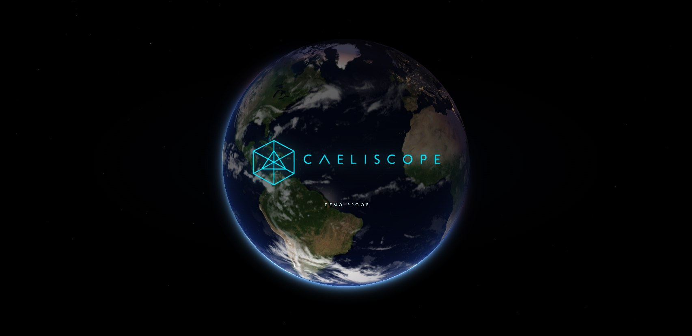
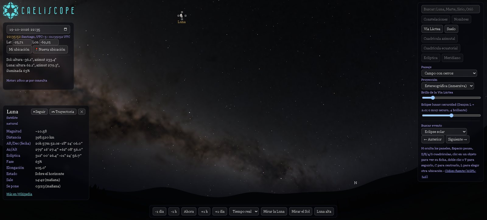
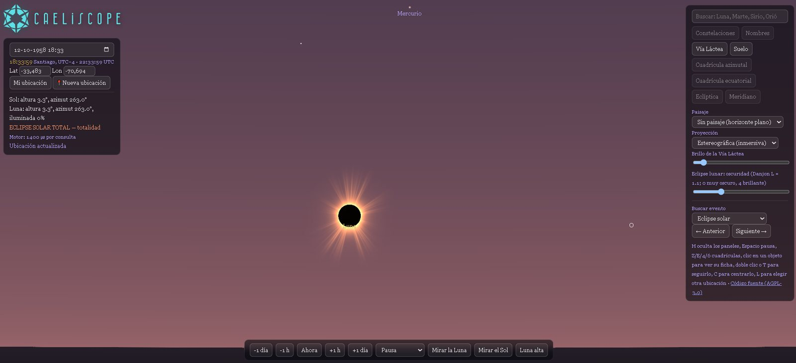
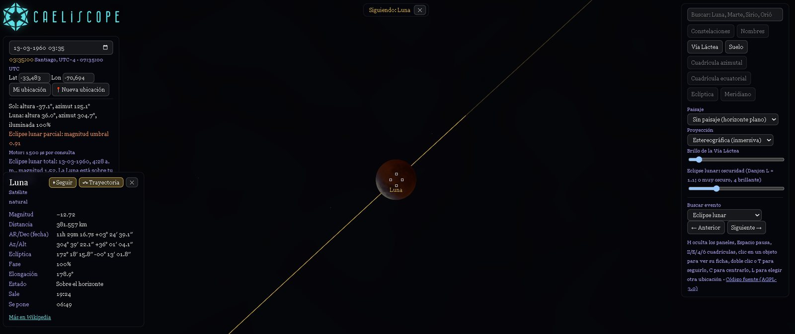
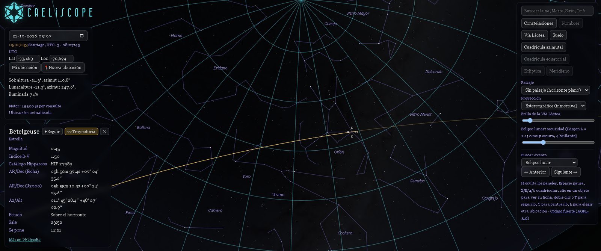

# Caeliscope

[](https://hermeticalabs.github.io/Caeliscope/)
[](https://github.com/HermeticaLabs/Caeliscope/actions/workflows/ci.yml)
[](LICENSE)
[](https://github.com/HermeticaLabs/caelis-engine)
[](https://github.com/HermeticaLabs/Caeliscope/stargazers)
[](package.json)

**Visor de cielo inmersivo construido sobre [Caelis Engine](https://github.com/HermeticaLabs/caelis-engine). Un technical demo proof de [Hermetica Labs](https://github.com/HermeticaLabs).**

Viaja desde el espacio hasta cualquier punto de la Tierra y mira hacia arriba: Sol, Luna, planetas, más de 5.000 estrellas con nombre, Vía Láctea y eclipses solares y lunares, con el cielo iluminado según la posición real del Sol. Cada posición en pantalla sale de una consulta a Caelis Engine; este repositorio es la capa visual.

> El motor es la estrella. Caeliscope es una de varias demostraciones que muestran los mismos datos deterministas presentados de formas muy distintas.

**[Abrir la demo en vivo →](https://hermeticalabs.github.io/Caeliscope/)**



## Galería

| | |
|---|---|
|  |  |
| Cielo nocturno con la Vía Láctea y la ficha de datos de la Luna | Eclipse solar total: corona y cielo oscurecido |
|  |  |
| Eclipse lunar, siguiendo a la Luna por su trayectoria | Constelaciones, grilla ecuatorial y la trayectoria de una estrella |

## Funciones

- **Viaje del globo al cielo** sobre imágenes NASA GIBS, y luego el cielo de ese lugar exacto, con las zonas horarias locales reales.
- **Viaje en el tiempo**: ruedas de fecha y hora, calendario con botón «Ir», velocidades desde tiempo real hasta minutos por segundo y la franja del día.
- **Buscador de eclipses y eventos**: próximo o anterior eclipse solar (total, anular, parcial) o lunar **visible desde tu ubicación**, además de equinoccios, solsticios y fases lunares.
- **Trayectorias por astro**: elige el Sol, la Luna o cualquiera de los 7 planetas y un alcance (±12 h, ±3 / ±6 meses, ciclo sinódico, roseta completa). Los tramos retrógrados tienen su propio color, se pueden etiquetar fechas y estaciones (℞ / D), el Sol tiene su **analema** y una ventana minimizable dibuja la geometría en vivo (por ejemplo la roseta de 5 pétalos de Venus).
- **Vista JSON en vivo**: da vuelta la ficha de cualquier objeto para ver el snapshot exacto de Caelis Engine que hay detrás; cópialo o descárgalo con sus metadatos.
- **Accesibilidad y comodidad**: español / inglés, tres tamaños de texto, opacidad ajustable de los paneles, **modo nocturno** rojo (`N`), paneles minimizables y atajos de teclado.

## Por qué existe

[Caelis Engine](https://github.com/HermeticaLabs/caelis-engine) es un motor de cálculo astronómico determinista y sin dependencias, escrito en JavaScript. Una biblioteca se juzga mejor por lo que la gente construye con ella. Caeliscope muestra que un mismo snapshot del cielo puede mover un visor de calidad de planetario, sin servidor, sin biblioteca de efemérides en C y sin API astronómica externa.

También está pensado para leerse: [`docs/GUIDE.md`](docs/GUIDE.md) (en inglés) explica cómo pasar de la salida del motor a un cielo en pantalla, incluida la conversión de los ángulos del motor a un `Vector3` de Three.js.

Toda posición, distancia, fase y hora que se muestra viene de [Caelis Engine](https://github.com/HermeticaLabs/caelis-engine), la única fuente de verdad. Este repositorio solo dibuja lo que el motor calcula.

## Ejecutar en local

Requisito: Node.js 22 o superior.

```bash
git clone https://github.com/HermeticaLabs/Caeliscope.git
cd Caeliscope
npm install
npm run dev        # http://localhost:5173
```

El motor viene dentro del repositorio como `src/engine/caelis-engine.generated.mjs`, un envoltorio para navegador de `CaelisEngine.js` (el repositorio del motor no se modifica). Para actualizarlo desde una copia local del motor:

```bash
npm run sync -- "ruta/a/caelis-engine/core/CaelisEngine.js"
npm test
```

Otros comandos: `npm run build` (paquete de producción en `dist/`), `npm run preview`, `npm test` (pruebas unitarias con el ejecutor integrado de Node). Cada `push` a `main` se compila y se publica en GitHub Pages con `.github/workflows/pages.yml`.

## Cómo está organizado

| Ruta | Responsabilidad |
|---|---|
| `src/main.mjs` | Aplicación: máquina de estados, interfaz, una consulta al motor por actualización |
| `src/sky-math.mjs`, `src/projection.mjs`, `src/stars.mjs` | Matemática pura: marco del observador, proyecciones, giro de las estrellas |
| `src/eclipse.mjs`, `src/magnitudes.mjs`, `src/events.mjs` | Eclipses, magnitudes aparentes, buscador de eventos |
| `src/trajectory.mjs` | Alcances de trayectoria, ciclos sinódicos, rosetas, detección de retrogradación, etiquetas de fecha |
| `src/globe.mjs`, `src/globe-math.mjs`, `src/tiles*.mjs` | Globo terrestre, viaje hasta el suelo, teselas NASA GIBS |
| `src/timeline.mjs`, `src/timezone.mjs` | Línea de tiempo de la portada, zonas horarias locales reales |
| `src/i18n.mjs`, `src/ui-prefs.mjs`, `src/snapshot-json.mjs` | Textos en español / inglés, preferencias de accesibilidad, exportación JSON |
| `src/shaders.mjs` | GLSL del cielo, Sol, Luna, corona y umbra |
| `test/` | Pruebas unitarias de cada módulo puro |

Todo lo que se puede calcular sin pantalla es una función pura con pruebas; WebGL solo dibuja lo que esas funciones decidieron.

## Controles

Arrastra para mirar alrededor, rueda o pellizco para acercar, clic en un objeto para su ficha de datos, doble clic o `T` para seguirlo, `C` para centrarlo, `L` para elegir otro lugar, `H` para ocultar los paneles, `N` para el modo nocturno, `F` para pantalla completa y `Espacio` para pausar el tiempo. El panel Opciones reúne capas, paisaje, proyección, alcance y etiquetas de trayectoria, tamaño de texto, opacidad de los paneles y el buscador de eventos.

## Licencia

Caeliscope es software libre bajo la **GNU Affero General Public License v3.0 o posterior** (ver [`LICENSE`](LICENSE)), la misma licencia que Caelis Engine. Si ejecutas una versión modificada como servicio de red, debes ofrecer su código fuente a tus usuarios (AGPL, sección 13); por eso la aplicación enlaza a este repositorio.

Los nombres **Caeliscope**, **Caelis Engine** y **Hermetica Labs** y sus logotipos son marcas de Hermetica Labs y **no** están licenciados bajo la AGPL; ver [`TRADEMARK.md`](TRADEMARK.md).

Los datos y recursos de terceros (catálogo estelar, texturas, teselas, tipografías) conservan sus propias licencias; ver [`NOTICE.md`](NOTICE.md) y [`public/THIRD-PARTY-LICENSES.txt`](public/THIRD-PARTY-LICENSES.txt).

## Contribuir

Se agradecen issues y pull requests; ver [`CONTRIBUTING.md`](CONTRIBUTING.md). Para reportes de seguridad ver [`SECURITY.md`](SECURITY.md).

English: [`README.md`](README.md)
