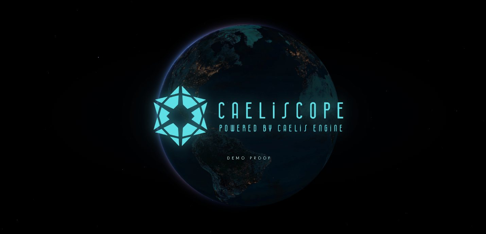
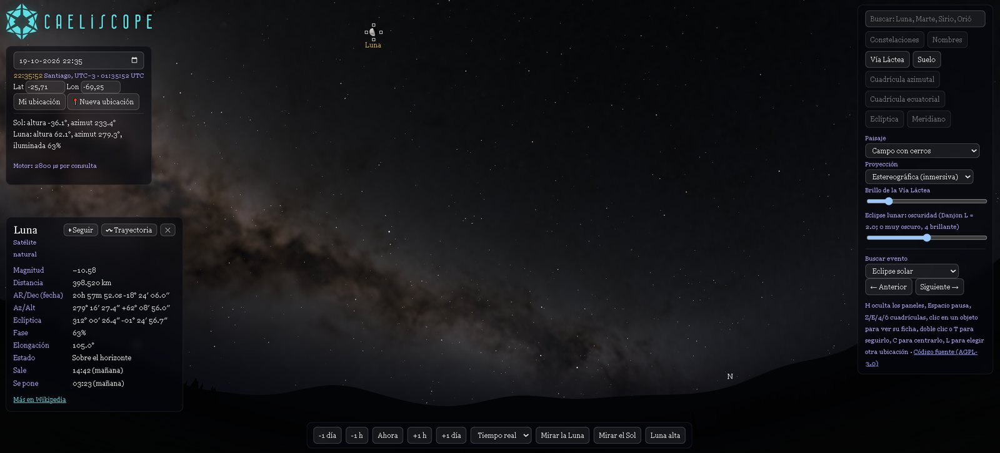
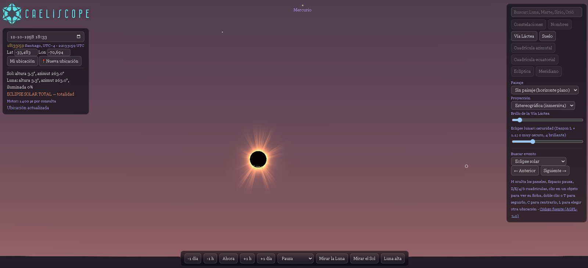
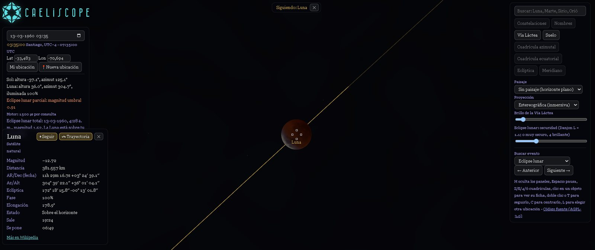
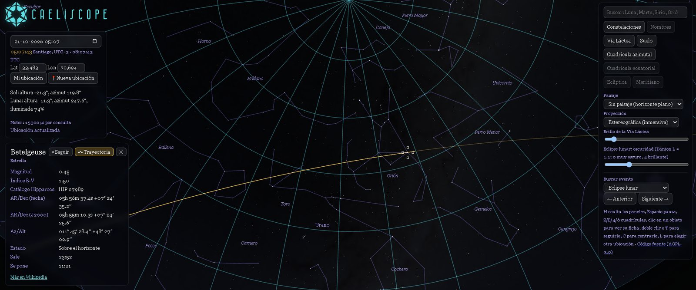

# Caeliscope

**An immersive sky viewer built on [Caelis Engine](https://github.com/hermeticalabs/caelis-engine). A technical demo proof by [Hermetica Labs](https://github.com/hermeticalabs).**

Fly from space down to any point on Earth and look up: Sun, Moon, planets, 5,000+ named stars, the Milky Way, solar and lunar eclipses, with the sky shaded by the real position of the Sun. Every position on screen comes from one call to Caelis Engine; this repository is the rendering layer on top.

> The engine is the star. Caeliscope is one of several demo proofs showing the same deterministic data presented in very different ways.



<!-- TODO: add a short GIF of the globe-to-sky journey -->

## Gallery

| | |
|---|---|
|  |  |
| Night sky with the Milky Way and a data card for the Moon | Total solar eclipse: corona and a darkened sky |
|  |  |
| Lunar eclipse, following the Moon along its path | Constellations, the equatorial grid and a star's trajectory |

## Why this exists

[Caelis Engine](https://github.com/hermeticalabs/caelis-engine) is a zero-dependency, deterministic astronomical computation engine in JavaScript. A library is easiest to judge by what people build with it. Caeliscope shows that the same snapshot of the sky can drive a planetarium-grade viewer, with no server, no C ephemeris library and no external astronomy API.

It is also meant to be read: [`docs/GUIDE.md`](docs/GUIDE.md) explains how to go from engine output to an on-screen sky, for professional and hobbyist developers.

Every position, distance, phase and time shown here comes from [Caelis Engine](https://github.com/hermeticalabs/caelis-engine), the single source of truth. This repository only draws what the engine computes.

## Live demo

<!-- TODO: https://hermeticalabs.github.io/caeliscope/ once deployed -->
_Coming soon._

## Run it locally

Requirements: Node.js 22 or newer.

```bash
git clone https://github.com/hermeticalabs/caeliscope.git
cd caeliscope
npm install
npm run dev        # http://localhost:5173
```

The engine ships inside the repo as `src/engine/caelis-engine.generated.mjs`, a browser wrapper around `CaelisEngine.js` (the engine repository is not modified). To update it from a local copy of the engine:

```bash
npm run sync -- "path/to/caelis-engine/core/CaelisEngine.js"
npm test
```

Other commands: `npm run build` (production bundle in `dist/`), `npm run preview`, `npm test` (unit tests, Node's built-in runner).

## How it is organised

| Path | Responsibility |
|---|---|
| `src/main.mjs` | Application: state machine, UI, one engine query per update |
| `src/sky-math.mjs`, `src/projection.mjs`, `src/stars.mjs` | Pure math: observer frame, projections, star rotation |
| `src/eclipse.mjs`, `src/magnitudes.mjs`, `src/events.mjs` | Eclipses, apparent magnitudes, event finder |
| `src/globe.mjs`, `src/globe-math.mjs`, `src/tiles*.mjs` | Earth globe, journey to the ground, NASA GIBS tiles |
| `src/timeline.mjs`, `src/timezone.mjs` | Splash timeline, real local time zones |
| `src/i18n.mjs` | English and Spanish: interface, bodies, constellations and star names |
| `src/shaders.mjs` | GLSL for sky, Sun, Moon, corona, umbra |
| `test/` | Unit tests for every pure module |

Anything that can be computed without a screen is a pure function with tests; WebGL only draws what those functions decided.

## Controls

Drag to look around, wheel or pinch to zoom, click an object for its data card, double-click or `T` to follow it, `C` to centre it, `L` to choose another location, `H` to hide panels, `Space` to pause time. The panels expose time travel (with a calendar and a Go button), projection, grids, landscape, an eclipse finder that only reports eclipses visible from your location, and a language switch (English by default, Spanish available).

## License

Caeliscope is free software under the **GNU Affero General Public License v3.0 or later** (see [`LICENSE`](LICENSE)), the same license as Caelis Engine. If you run a modified version as a network service, you must offer its source to your users (AGPL section 13); the app links to this repository for that reason.

The names **Caeliscope**, **Caelis Engine** and **Hermetica Labs** and their logos are trademarks of Hermetica Labs and are **not** licensed under the AGPL; see [`TRADEMARK.md`](TRADEMARK.md).

Third-party data and assets (star catalogue, textures, tiles, fonts) keep their own licenses; see [`NOTICE.md`](NOTICE.md).

## Contributing

Issues and pull requests are welcome; see [`CONTRIBUTING.md`](CONTRIBUTING.md). For security reports see [`SECURITY.md`](SECURITY.md).

Español: [`README.es.md`](README.es.md)
