<div align="center">

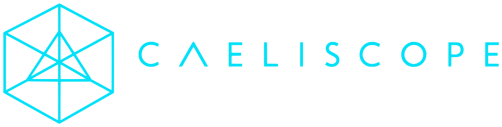

# Caeliscope

**An immersive sky viewer built on [Caelis Engine](https://github.com/HermeticaLabs/caelis-engine). A technical demo proof by [Hermetica Labs](https://github.com/HermeticaLabs).**

[](https://hermeticalabs.github.io/Caeliscope/)
[](https://github.com/HermeticaLabs/Caeliscope/actions/workflows/ci.yml)
[](https://hub.xerj.org/contributors/HermeticaLabs)
[](LICENSE)
[](https://github.com/HermeticaLabs/caelis-engine)
[](https://github.com/HermeticaLabs/Caeliscope/stargazers)
[](package.json)

English · [Español](README.es.md)

</div>

Fly from space down to any point on Earth and look up: Sun, Moon, planets, 5,000+ named stars, the Milky Way, solar and lunar eclipses, with the sky shaded by the real position of the Sun. Every position on screen comes from one call to Caelis Engine; this repository is the rendering layer on top.

> The engine is the star. Caeliscope is one of several demo proofs showing the same deterministic data presented in very different ways.

**[Open the live demo →](https://hermeticalabs.github.io/Caeliscope/)**

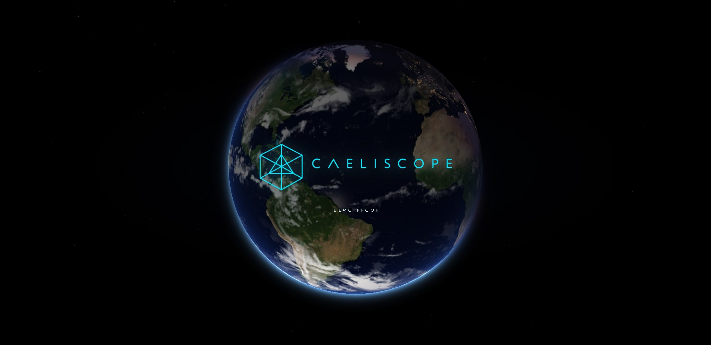

**[Read the documentation](https://hermeticalabs.github.io/Caeliscope/docs/)** — user guide, JSON reference and moon plugins (English and Spanish).

## Gallery

| | |
|---|---|
| 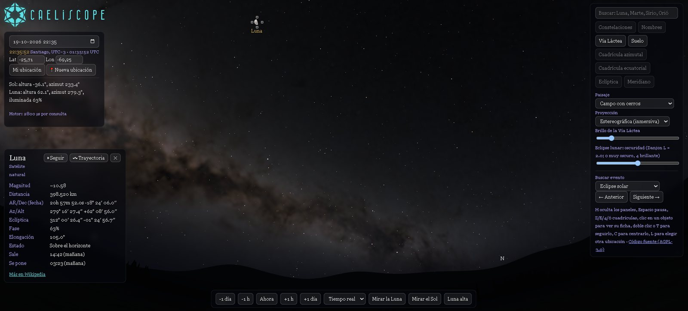 | 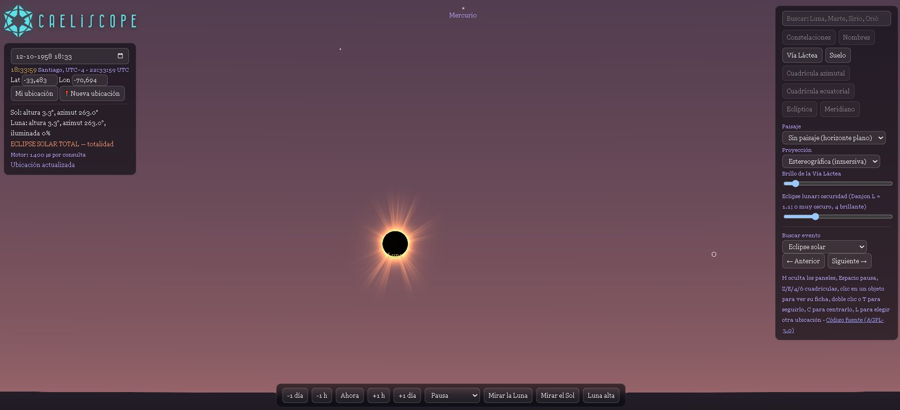 |
| Night sky with the Milky Way and a data card for the Moon | Total solar eclipse: corona and a darkened sky |
| 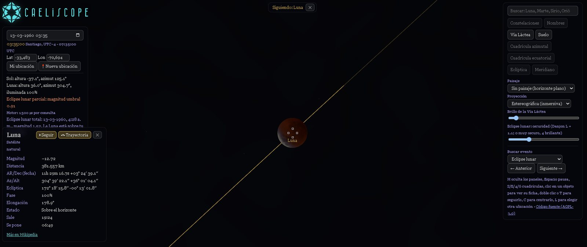 | 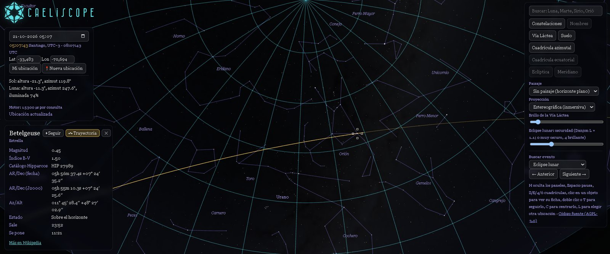 |
| Lunar eclipse, following the Moon along its path | Constellations, the equatorial grid and a star's trajectory |
| 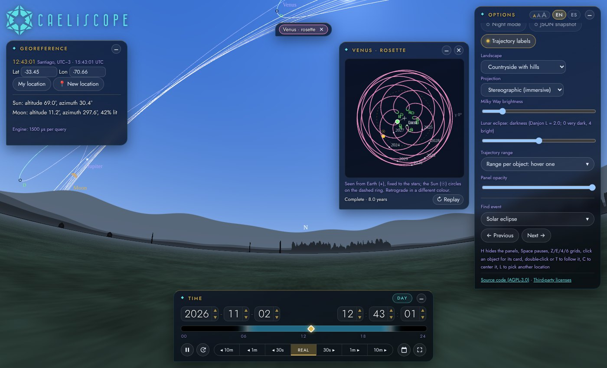 | 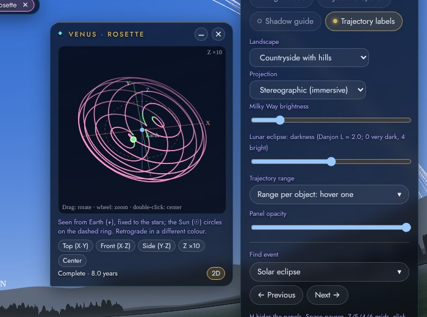 |
| Venus's rosette (8 years, 5 synodic cycles); the retrograde stretches use their own colour | The same cycle as a 3D object: rotate X / Y / Z, zoom, **Center** to restore |
| 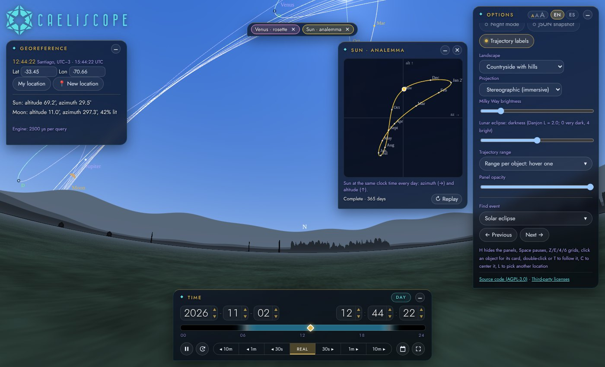 | 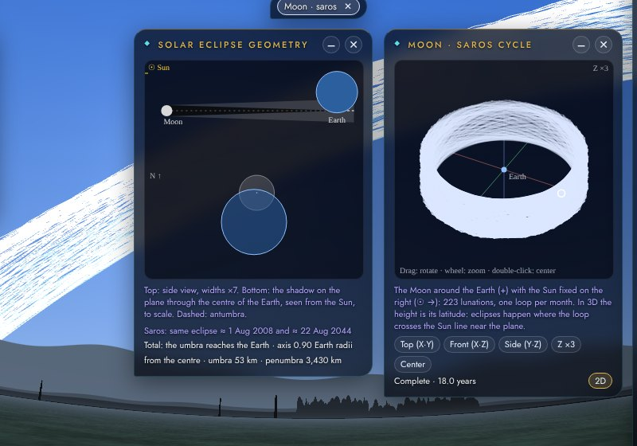 |
| The Sun's analemma: its position at the same clock time every day for a year | Shadow guide (umbra, penumbra, Saros return dates) beside the Moon's Saros cycle |
| 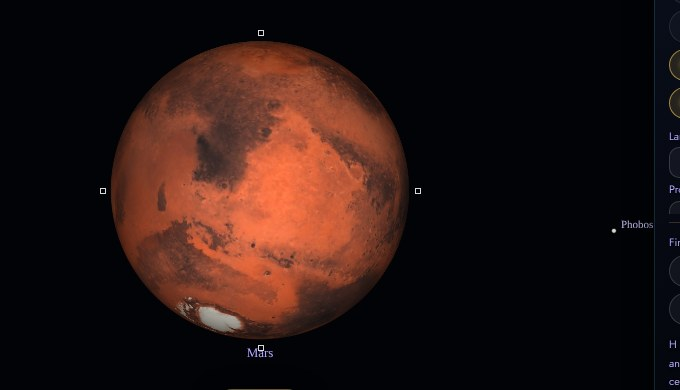 | 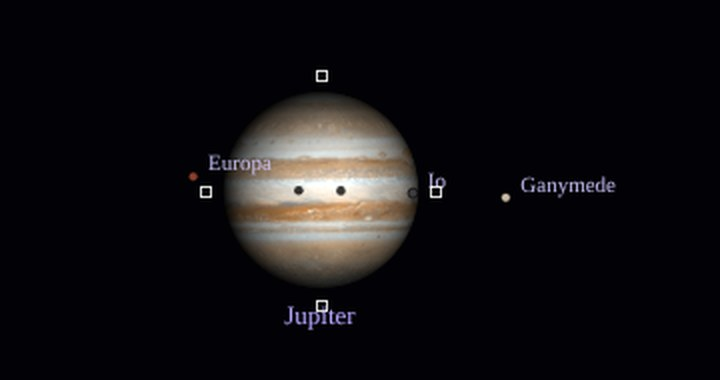 |
| Mars near opposition with Phobos (moons plugin) | Jupiter: Io in transit, the shadows of Io and Ganymede on the disc, Europa inside Jupiter's shadow |
| 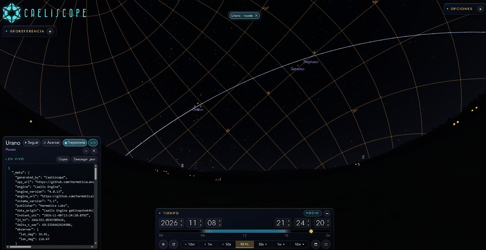 | 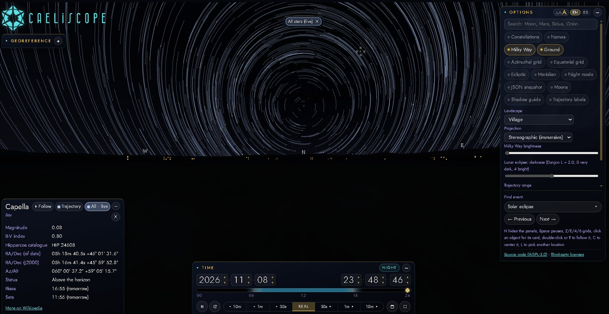 |
| Uranus's rosette traced against the stars, next to the live JSON view of its data card | Star trails of all the stars, live, turning around the celestial pole; Capella's card and the options panel |
| 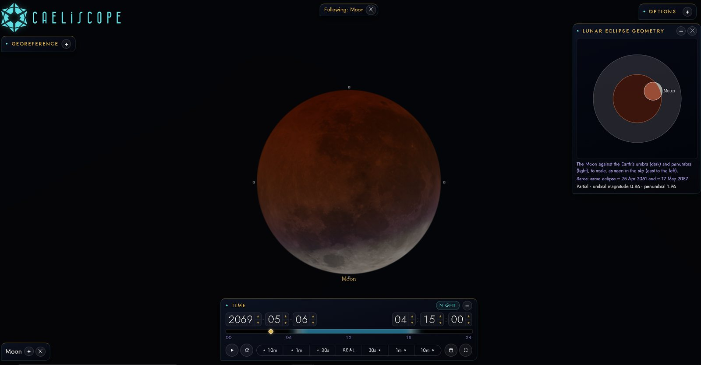 | 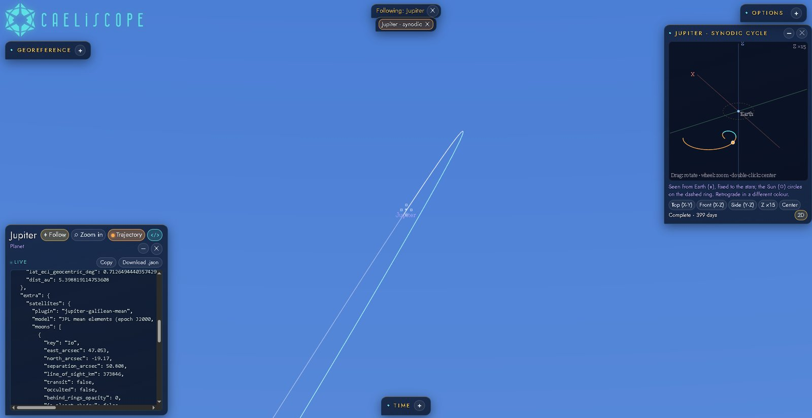 |
| Partial lunar eclipse (2069) with its geometry window: the Moon against the umbra and penumbra, and the Saros return dates | Jupiter's synodic cycle (399 days) in the 3D geometry window, with the JSON of the planet and its moons |

## Features

- **Globe to sky journey** over NASA GIBS imagery, then the sky of that exact place, with real local time zones.
- **Time travel**: date and time wheels, a calendar with a "Go" button, speeds from real time to minutes per second, and the day strip.
- **Eclipse and event finder**: next or previous solar eclipse (total, annular, partial) or lunar eclipse **visible from your location**, plus equinoxes, solstices and lunar phases.
- **Trajectories per object**: pick the Sun, the Moon or any of the 7 planets and a range (±12 h, ±3 / ±6 months, synodic cycle, full rosette). Retrograde stretches get their own colour, dates and stations (℞ / D) can be labelled, the Sun has an **analemma** and the Moon a **Saros cycle** (223 lunations).
- **Geometry window**: synodic cycle, rosette, analemma and Saros open a minimizable window that draws the geometry live (such as Venus's 5-petal rosette). Switch it to an interactive **3D view** of the complete cycle: rotate X / Y / Z, zoom, preset views (top, front, side) and a **Center** button. The window can be dragged by its title bar and never overlaps another panel.
- **Shadow guide**: the shadow cones of a solar eclipse (Moon's umbra, penumbra and antumbra, side view and to-scale plane through the Earth's centre) or a lunar eclipse (the Moon against the Earth's umbra and penumbra), with the Saros dates when the same eclipse repeats.
- **Moons (plugins)**: Phobos and Deimos around Mars, the four Galilean moons around Jupiter the six classical moons around Saturn and the five major moons around Uranus and Triton and Nereid around Neptune (oblate planets, moons hidden behind the rings), appear when you zoom in, with transit, occultation behind the planet, eclipse in its shadow and the **shadow of each moon on the planet's disc**; the planet's card lists their separation and state. They never appear in trails, geometries or rosettes. Toggle them under **Moons**.
- **Moon cards**: click a moon to open its own card (magnitude, apparent size, distance from the planet's centre, orbital period and direction, position, transit / occultation / eclipse state) with the JSON view like any other object.
- **Shaped, lit moons**: each moon is drawn as a triaxial ellipsoid (Phobos and Deimos elongated, Mimas and Nereid irregular), locked to its planet as in reality, with its current phase and orientation, in the sky when zoomed in and as a portrait on its card. Surface maps are real NASA/USGS mosaics; a moon without a map shows a neutral procedural surface.
- **Installable (PWA)**: install it from the browser as an app on desktop or mobile; after the first visit it opens offline (only the NASA map detail of the globe needs a connection).
- **Live JSON view**: flip any object card to the exact Caelis Engine snapshot behind it, copy or download it with metadata.
- **Accessibility and comfort**: English / Spanish, three text sizes, adjustable panel opacity, a red **night mode** (`N`), minimizable panels, keyboard shortcuts.

## Roadmap

The engine is frozen for now. Natural satellites are being added one by one as **plugins** of Caeliscope (`src/satellites/`), working on the positions the engine already resolves for each planet's centre. **Mars (Phobos, Deimos), Jupiter (Io, Europa, Ganymede, Callisto) and Saturn (Mimas, Enceladus, Tethys, Dione, Rhea, Titan) are in**, using JPL mean elements with secular precession (the Galilean moons keep the Laplace resonance; Saturn's inner moons keep the Enceladus–Dione and Mimas–Tethys resonances); Uranus (Miranda, Ariel, Umbriel, Titania, Oberon; axis tilted ~98°) is in too, and so is Neptune (Triton, which orbits backwards, and Nereid, with a very eccentric orbit), completing the planets with major moons. Moons are drawn in the sky and in the planet views, never in trails, geometries or rosettes, and are meant to be mathematically coherent (shape, transit and physics relative to their planet) rather than extremely precise.

## Why this exists

[Caelis Engine](https://github.com/HermeticaLabs/caelis-engine) is a zero-dependency, deterministic astronomical computation engine in JavaScript. A library is easiest to judge by what people build with it. Caeliscope shows that the same snapshot of the sky can drive a planetarium-grade viewer, with no server, no C ephemeris library and no external astronomy API.

It is also meant to be read: [`docs/GUIDE.md`](docs/GUIDE.md) explains how to go from engine output to an on-screen sky (including turning the engine's angles into a Three.js `Vector3`), for professional and hobbyist developers.

Every position, distance, phase and time shown here comes from [Caelis Engine](https://github.com/HermeticaLabs/caelis-engine), the single source of truth. This repository only draws what the engine computes.

## Run it locally

Requirements: Node.js 22 or newer.

```bash
git clone https://github.com/HermeticaLabs/Caeliscope.git
cd Caeliscope
npm install
npm run dev        # http://localhost:5173
```

The engine ships inside the repo as `src/engine/caelis-engine.generated.mjs`, a browser wrapper around `CaelisEngine.js` (the engine repository is not modified). To update it from a local copy of the engine:

```bash
npm run sync -- "path/to/caelis-engine/core/CaelisEngine.js"
npm test
```

Other commands: `npm run build` (production bundle in `dist/`), `npm run preview`, `npm test` (unit tests, Node's built-in runner). Every push to `main` is built and published to GitHub Pages by `.github/workflows/pages.yml`.

## How it is organised

| Path | Responsibility |
|---|---|
| `src/main.mjs` | Application: state machine, UI, one engine query per update |
| `src/sky-math.mjs`, `src/projection.mjs`, `src/stars.mjs` | Pure math: observer frame, projections, star rotation |
| `src/eclipse.mjs`, `src/magnitudes.mjs`, `src/events.mjs` | Eclipses, apparent magnitudes, event finder |
| `src/trajectory.mjs` | Trajectory ranges, synodic and Saros cycles, rosettes, retrograde detection, date labels |
| `src/shadow.mjs` | Umbra / penumbra / antumbra geometry for solar and lunar eclipses |
| `src/satellites/` | Satellite plugins: Kepler orbits with Laplace-plane elements, sky positions, transit / occultation / eclipse; Mars, Jupiter, Saturn, Uranus and Neptune plugins |
| `src/view3d.mjs`, `src/winpos.mjs`, `src/lru.mjs` | 3D view maths, non-overlapping floating windows, bounded cache (last 5 geometries) |
| `src/globe.mjs`, `src/globe-math.mjs`, `src/tiles*.mjs` | Earth globe, journey to the ground, NASA GIBS tiles |
| `src/timeline.mjs`, `src/timezone.mjs` | Splash timeline, real local time zones |
| `src/i18n.mjs`, `src/ui-prefs.mjs`, `src/snapshot-json.mjs` | English / Spanish text, accessibility preferences, JSON export |
| `src/shaders.mjs` | GLSL for sky, Sun, Moon, corona, umbra |
| `test/` | Unit tests for every pure module |

Anything that can be computed without a screen is a pure function with tests; WebGL only draws what those functions decided.

## Controls

Drag to look around, wheel or pinch to zoom, click an object for its data card, double-click or `T` to follow it, `C` to centre it, `L` to choose another location, `H` to hide panels, `N` for night mode, `F` for full screen, `Space` to pause time. The Options panel holds layers, landscape, projection, trajectory range and labels, text size, panel opacity and the event finder.

## License

Caeliscope is free software under the **GNU Affero General Public License v3.0 or later** (see [`LICENSE`](LICENSE)), the same license as Caelis Engine. If you run a modified version as a network service, you must offer its source to your users (AGPL section 13); the app links to this repository for that reason.

The names **Caeliscope**, **Caelis Engine** and **Hermetica Labs** and their logos are trademarks of Hermetica Labs and are **not** licensed under the AGPL; see [`TRADEMARK.md`](TRADEMARK.md).

Third-party data and assets (star catalogue, textures, tiles, fonts) keep their own licenses; see [`NOTICE.md`](NOTICE.md) and [`public/THIRD-PARTY-LICENSES.txt`](public/THIRD-PARTY-LICENSES.txt).

## Contributing

Issues and pull requests are welcome; see [`CONTRIBUTING.md`](CONTRIBUTING.md). For security reports see [`SECURITY.md`](SECURITY.md).

Español: [`README.es.md`](README.es.md)

<p align="center">
  <a href="https://github.com/HermeticaLabs">
    <picture>
      <source media="(prefers-color-scheme: dark)" srcset="docs/img/hermetica-labs-light.svg">
      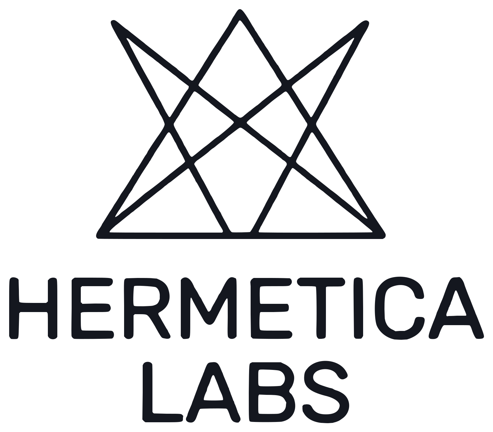
    </picture>
  </a>
</p>
